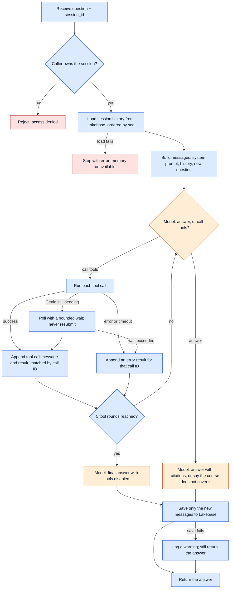

# Agent orchestration

How the lecture insights assistant answers a follow-up question. Code runs the fixed steps; the
model makes the choices. The tools are the [v1 tool set](AGENT_TOOLS.md#v1-tool-set). The
post-lecture digest has its own fixed flow and is not covered here.

## Why this split

Follow-up questions are open-ended and need different tools each time, so the model chooses which
to call. Session access, memory, limits and error handling stay in code, so every run behaves the
same and fails visibly.

## Flow

Blue steps are code-controlled. Orange steps are model-directed.

## Stopping conditions

- The model answers without calling a tool.
- The agent reaches 5 tool rounds. One last model call, with tools disabled, answers from what it
  has gathered. Five is a starting value; testing the tools confirms or changes it.
- The session check or the history load fails. The request stops before the model is called.

## Failure paths

| Failure | What happens | Why |
|---|---|---|
| A tool raises an error or times out | The model gets an error result for that call ID. It can try another tool or tell the user. Errors count toward the 5 rounds. | The model can recover, and the limit stops a retry loop. |
| Genie is still working | Code polls the same message with a bounded wait, then returns a "pending" error. | Polling never asks a new question; resubmitting would duplicate it. |
| History fails to load | The request stops with an error. | An empty history would hide the failure and break follow-ups. |
| History fails to save | The answer is returned and a warning is logged. | The lecturer still gets the answer; the next turn shows the gap. |
| The model replies with neither text nor tool calls | Code asks again with tools disabled, retrying that call once. | GPT-OSS returns an empty reply now and then; the lecturer must never get a blank answer silently. |
| The caller does not own the session | The request is rejected. | A session ID alone is not an authorization check. |

## Questions outside the course

When `search_course_content` returns nothing relevant and Genie does not apply, the model says the
course material does not cover the question. It does not answer from general knowledge. A score
threshold does not decide this: in testing, an off-course question scored 0.64, while relevant chunks
scored from 0.58 to 0.78. The model judges relevance from the excerpts instead.

## Session memory

The session table, the owner check and the identities are in [SESSION_MEMORY.md](SESSION_MEMORY.md).
