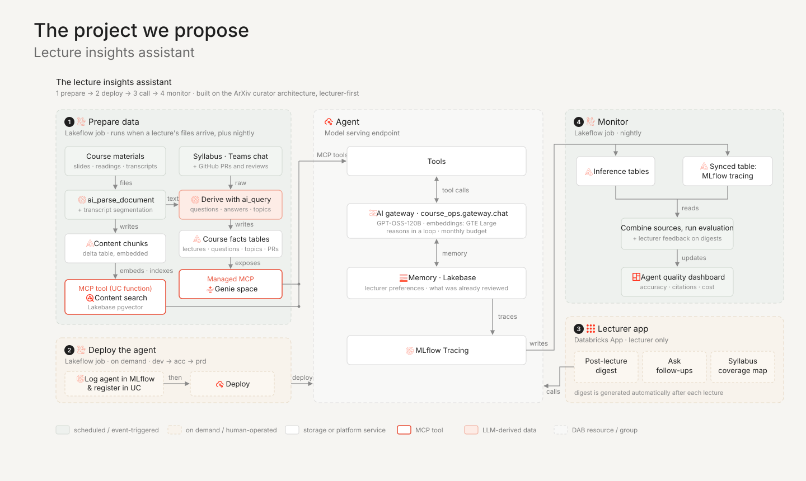

# Project proposal: Lecture insights assistant

An agent that helps a **lecturer** understand what happened in their course: what students
asked, what was left unanswered, which syllabus topics were covered, and where the cohort
struggles in its code. It is built on the course's ArXiv curator reference architecture, with the
changes this use case needs.

## Problem

A lecturer teaching around 50 students over several weeks has no structured view of their own
course. Questions arrive by voice and in the Teams chat, often several at once, and some are
never answered. Confusion about a topic shows up across several lectures and in pull requests, but
nobody connects it. At the end of the course it is hard to say which syllabus topics were taught
well, rushed, or skipped.

The information exists in slides, readings, Teams transcripts and chats, and the course's git
repositories. It is just too scattered and too large to review by hand.

## User and scope

- **Primary user: the lecturer.** v1 is lecturer-only. Students do not use the agent.
- **Size:** one course, about 50 students. Students are mostly in the EU, some in the UK and US.
- **Git work is not graded.** Opening PRs is a requirement to pass, not a mark. This keeps the
  stakes of the PR features low, but they still involve personal data (see
  [Privacy](#privacy-and-compliance)).

Out of scope for v1: a student-facing assistant, grading support, and per-student
rankings or scores.

## What the lecturer gets

### 1. Post-lecture digest (core feature)
Generated automatically once a lecture's transcript and chat are available:
- **Questions asked**, by voice and in chat, each marked *answered*, *partly answered* or
  *not answered*, with the timestamp where it was asked and where it was answered.
- **Syllabus coverage** for the lecture: the topics planned for this week that were covered, only
  touched on, or not covered.
- **Signs of confusion**: repeated questions, "can you repeat that?", long back-and-forths.
- **A draft recap** to open the next lecture or post to the class: the open questions, answered
  with pointers to slides and readings.

### 2. Ask follow-up questions
A chat over the whole course so far. For example:
- "What did students ask about Unity Catalog, across all lectures?"
- "When did I first explain checkpointing, and on which slide?"
- "Which questions keep coming back?"
- "What were the most common review comments on the assignment 2 PRs?"
- "Did I cover everything the syllabus promised for week 3?"

Every answer cites its source: a slide number, a reading, or a lecture with a timestamp.

### 3. Syllabus coverage map
A view per week of each syllabus topic against what was taught, what was asked about, and what
showed up in PR reviews. It is mainly useful for revising the course before it runs again.

### PR insights: by topic, not by student
PR data is summarized by **topic and assignment**, for example "12 PRs had the same idempotency
issue" or "assignment 3 needed the most review rounds". It does not rank or profile individual
students. The lecturer can still look at a specific PR in GitHub directly. The agent does not add
a layer of profiling on top.

## Data sources

| Source | Used for | How it arrives (v1) |
|---|---|---|
| Slide decks, readings | Citations, explanations, what was planned | Uploaded to a UC volume |
| Syllabus | **The backbone.** Weeks, topics and learning objectives that everything else is tagged against | Uploaded once, parsed into a topics table |
| Teams transcripts | What was said and when, answers to questions | Exported after each lecture to a UC volume |
| Teams chat | Questions asked in writing | Exported after each lecture to a UC volume |
| GitHub PRs and reviews | Recurring mistakes and review themes | GitHub API, nightly |

In v1, Teams exports are uploaded by hand rather than pulled through the Microsoft Graph API.
This is simpler, and it keeps the lecturer in control of what goes in.

## Architecture

The structure follows the ArXiv curator: **1 prepare → 2 deploy → 3 call → 4 monitor**.

### 1 · Prepare data (Lakeflow job)
- **Content path (left column):** slides, readings and transcripts are parsed with
  `ai_parse_document`, and transcripts are split into segments that keep their timestamps. The
  chunks are embedded with the course embedding service (GTE Large) and stored in
  **Lakebase pgvector**. A UC function exposes content search to the agent as an MCP tool.
- **Facts path (right column):** the syllabus, chat logs, PR data and transcript segments go
  through an `ai_query` step that produces **LLM-derived data**. It extracts questions, matches them
  to answers, and tags everything to syllabus topics. The results land in Delta tables (`lectures`,
  `questions`, `syllabus_topics`, `pr_activity`), and a **Genie space** over those tables is
  exposed as a managed MCP.

### 2 · Deploy the agent (Lakeflow job, on demand)
The same as the reference: log the agent in MLflow, register it in Unity Catalog and deploy it
through the bundle's `dev → acc → prd` targets.

### Agent (model serving endpoint)
- **Tools:** content search (pgvector) for "where and how was X explained" questions, and Genie
  for "what, how many, which were unanswered" questions. The full proposed tool set is in
  [AGENT_TOOLS.md](AGENT_TOOLS.md).
- **Model:** `course_ops.gateway.chat` (GPT-OSS-120B), called through the course AI Gateway
  within the monthly budget.
- **Memory (Lakebase):** the lecturer's preferences (recap style and length) and which digest
  items they have already reviewed or dismissed.
- **MLflow Tracing** on every call.

### 3 · Lecturer app (Databricks App)
The digest, the follow-up chat and the coverage map, for the lecturer only. The digest is
generated by calling the agent once a lecture's prepare run has finished.

### 4 · Monitor (Lakeflow job, nightly)
Combines inference tables and traces, runs the evaluation scorers, includes the lecturer's
feedback on digest items, and updates the agent quality dashboard.

### Deviations from the ArXiv curator

| Change | Why |
|---|---|
| Prepare runs **when a lecture's files arrive**, not only on a schedule | The digest is most useful on the day of the lecture |
| **LLM-derived data is the core** (question extraction, answer matching, topic tagging) | It creates the data the lecturer features depend on. In the ArXiv curator, parsing is only plumbing. |
| **Lakebase pgvector** instead of a managed Vector Search index | The course provisions Lakebase and gateway embeddings, not a Vector Search endpoint |
| The **app is the product surface**, with a digest as well as chat | A proactive digest is worth more to a busy lecturer than a chat box |
| **Lecturer feedback** feeds the monitor | Dismissed or corrected digest items are the best quality signal available |

## Privacy and compliance

Students speak and write in the source data. With about 50 people, pseudonymization doesn't
protect much, because the lecturer recognizes voices and writing styles. So the design treats
the data as personal data and relies on clear limits:

- **Notice and lawful basis:** students are told before the course that lectures and chats are
  transcribed and analyzed to improve teaching. The lawful basis is GDPR and UK GDPR (typically the
  institution's legitimate interest or public task), confirmed with the institution.
- **Analyze the material, not the people:** questions are grouped by topic, and PR insights are
  aggregated. There are no per-student profiles, scores or rankings.
- **Minimization:** the digest shows question text, not who asked it, unless the lecturer
  needs to follow up.
- **Retention:** transcripts and chat exports are deleted a set time after the course ends.
  Aggregated, de-identified insights for course revision may be kept.
- **Region and access:** data stays in the course workspace's region. Only the lecturer (and the
  course operators) can access the app and the tables.

## Evaluation

| What | How |
|---|---|
| Question extraction | Precision and recall against a hand-labeled lecture: were all questions found, and nothing invented? |
| Answered / unanswered | Precision of the *unanswered* label. A false "unanswered" quickly costs the lecturer's trust. |
| Topic tagging | Agreement with the lecturer's own tags on a sample |
| Follow-up answers | Correctness, groundedness and citation validity: does the slide or timestamp really contain it? |
| Retrieval | Recall@k and MRR against expected slides and lecture segments |
| Usefulness | Does the lecturer open the digest, and how many items do they dismiss? |

The golden dataset starts with one or two lectures labeled by the lecturer and grows from
corrections made in the app.

## Milestones

1. **Content Q&A:** The agent answers "where did I explain X?" with timestamped citations.
2. **LLM-derived data and digest:** The pipeline generates the first post-lecture digest.
3. **Lecturer app:** The lecturer reviews the digest, chat and coverage map in a Databricks App.
4. **Monitoring:** The monitor job scores the agent and updates the quality dashboard.
5. **PR insights:** The pipeline groups GitHub review themes by topic and assignment.

## Risks and open questions

- **Transcript quality:** speech-to-text mangles technical terms (Delta, Unity Catalog,
  idempotent). Mitigation: a glossary built from the slides, used to correct transcripts.
- **Teams export format:** The team confirms what the institution's Teams setup can export
  (transcript with timestamps and speakers, chat with timestamps).
- **Chilling effect:** students may ask fewer questions in chat if they know it is analyzed. Clear
  communication and the no-profiling rule are the main mitigations.
- **Budget:** producing the LLM-derived data runs an LLM over every transcript. The team checks the
  cost per lecture against the monthly gateway budget early.
- **Later:** a student-facing assistant over course content, behind its own access rules and a
  tutoring-only mode.
